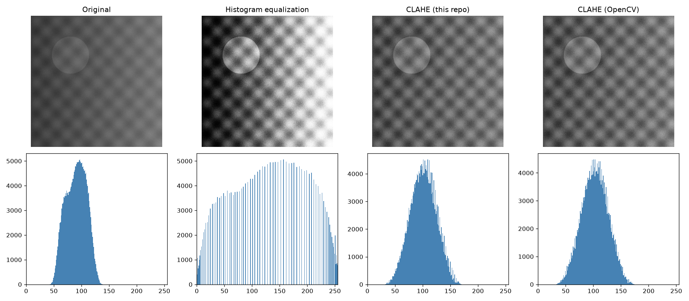

# CLAHE Image Enhancement

CLAHE (Contrast Limited Adaptive Histogram Equalization) written from scratch in NumPy and compared with global histogram equalization and OpenCV's `cv2.createCLAHE`.



## Why CLAHE
Global histogram equalization stretches contrast using the histogram of the whole image. Under uneven lighting it washes out bright regions and amplifies noise in flat ones. CLAHE fixes this in three steps:

1. Split the image into tiles (8×8 by default) and equalize each tile on its own histogram.
2. Clip every histogram bin at a limit and spread the excess evenly over all bins. This caps how much contrast, and noise, a flat region can gain.
3. Blend the mappings of the four nearest tiles with bilinear interpolation so no tile edges show.

## Files
```
clahe.py   # clahe(img, clip_limit, grid)
demo.py    # original / HE / this CLAHE / OpenCV CLAHE, histograms and PSNR
results/   # output images
```

## Running
```bash
pip install -r requirements.txt
python demo.py                            # synthetic low-contrast image
python demo.py --image photo.jpg --clip 3 --grid 8
```
On the synthetic image the output matches OpenCV at 43 dB PSNR.

## Uses
Preprocessing for X-ray and other medical images, low-light photos, automated optical inspection, and as a first step before feature detection.
