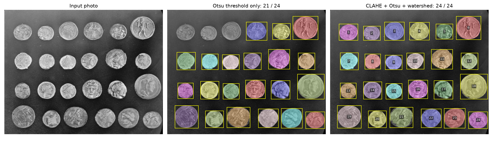
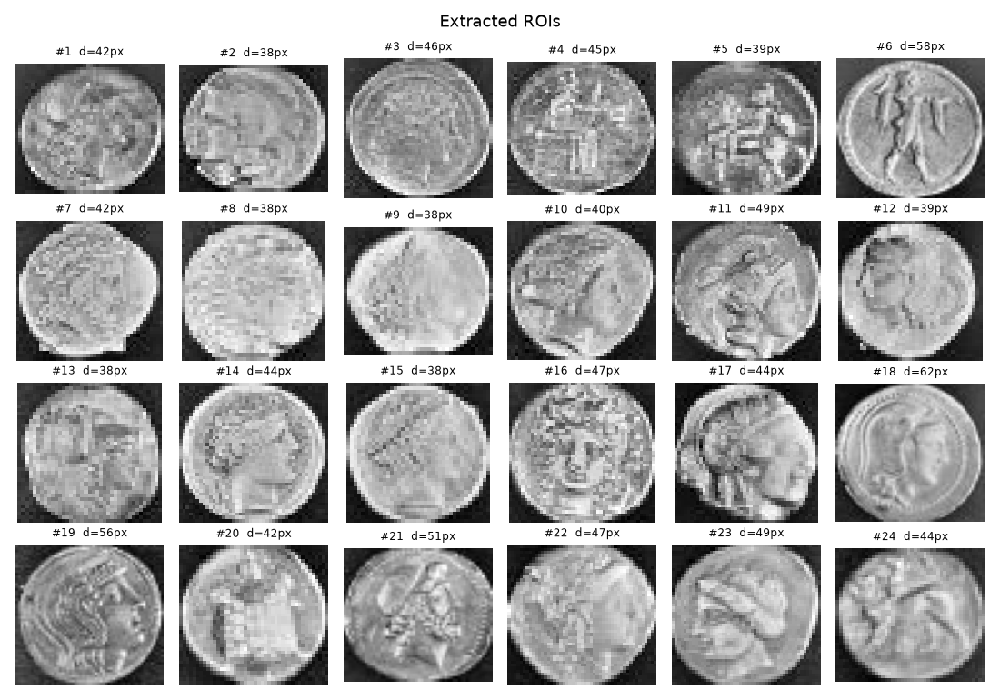
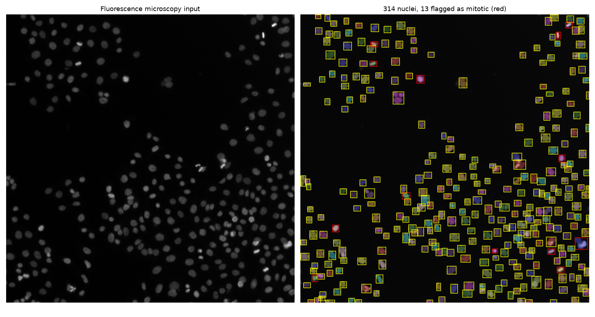
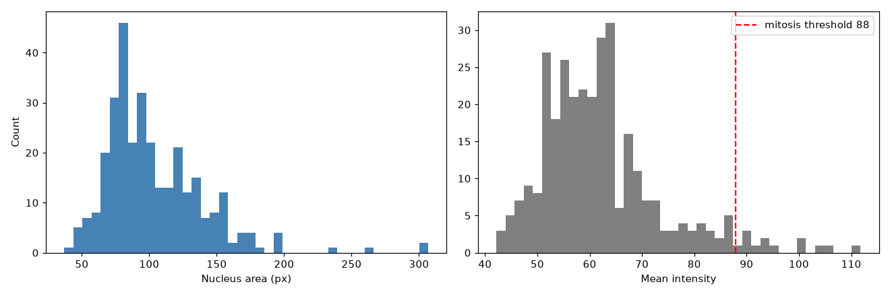

# ROI Object Detection with CLAHE

Finds and measures objects in photos with uneven lighting. Each object becomes a region of interest (ROI) with its bounding box, centre, area, diameter, circularity and mean intensity, exported to CSV.

Pipeline: CLAHE (written from scratch in NumPy) → Gaussian blur → Otsu threshold → morphological cleanup → distance transform + watershed to split touching objects → region measurements and filters.



## Results on real photos
Both images come from scikit-image's sample data.

| Image | Method | Detected | True |
|---|---|---|---|
| Coins (uneven lighting) | Otsu threshold only | 21 | 24 |
| Coins (uneven lighting) | CLAHE + Otsu + watershed | **24** | 24 |
| Fluorescence microscopy | CLAHE + Otsu + watershed | 314 nuclei | n/a |
| Fluorescence microscopy | intensity > median + 3·MAD | 13 mitotic (4.1 %) | n/a |

**Coins.** The top-left of the photo is brighter than the rest. A single Otsu threshold puts the background there above the threshold, so three coins merge into it and are lost. After CLAHE the threshold works locally and all 24 coins are found with no false detections. Each coin is cropped and saved as its own ROI.



**Cell nuclei.** Touching nuclei are split with the watershed. Dividing cells have condensed chromosomes and show up much brighter than the rest, so nuclei with a mean intensity above median + 3·MAD are flagged as mitotic (red boxes).




Per-object measurements are in `results/coins_rois.csv` and `results/nuclei_rois.csv`.

## CLAHE
Global histogram equalization uses the histogram of the whole image, so under uneven lighting it washes out bright areas and boosts noise in flat ones. CLAHE works per tile:

1. Split the image into tiles and equalize each one separately.
2. Clip each histogram bin at a limit and spread the excess over all bins, which limits how much contrast and noise a flat region can gain.
3. Blend the mappings of the four nearest tiles with bilinear interpolation so the tile edges don't show.

The NumPy implementation matches `cv2.createCLAHE` at 43.7 dB PSNR on the moon photo below.


## Files
```
clahe.py        CLAHE in NumPy
roi.py          segmentation and ROI measurements
examples.py     coin counting and nuclei counting, writes results/
detect.py       run the pipeline on your own image
demo_clahe.py   original / HE / CLAHE / OpenCV CLAHE with histograms
results/        images and CSV output
```

## Running
```bash
pip install -r requirements.txt
python examples.py
python detect.py photo.jpg --min-area 200
python detect.py photo.jpg --dark --no-split
python demo_clahe.py
```
